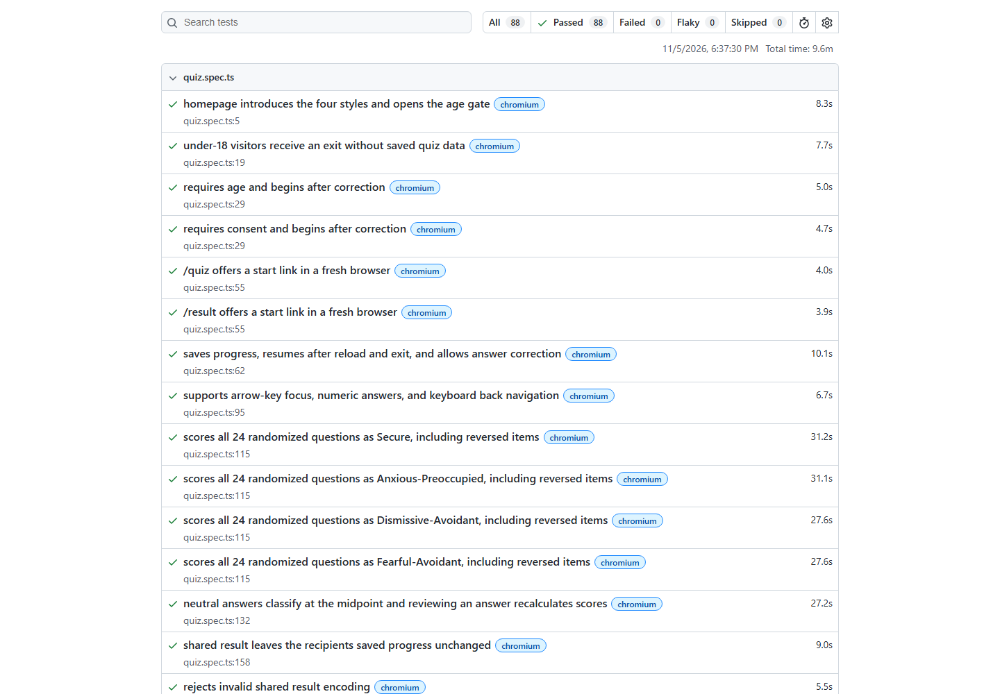

# MTech Attachment Quiz — Playwright Automation

A standalone QA automation portfolio project for the [MTech Attachment Style Quiz](https://quiz.mtechcorpja.com/), built with Playwright and TypeScript.

**22 scenarios across four browser profiles: 88 test cases.** Covers the adult age gate, consent validation, all 24 randomized questions, reverse scoring for all four attachment styles, saved progress, answer corrections, sharing, PNG downloads, keyboard controls, and responsive layout.

## Recorded results

The original live run on November 5, 2026 passed **88 tests with zero failures, flaky tests, or skipped cases in 9.6 minutes**. The screenshot records the same tests before they were extracted into this standalone repository. GitHub Actions generates fresh reports for this project.



## Run locally

Install Node.js 24 LTS, then:

```sh
npm ci
npx playwright install
npm test
npm run report
```

For a quick run or visible demonstration:

```sh
npm run test:chromium
npm run test:headed
npm run test:ui
```

On Linux, use `npx playwright install --with-deps` to install browser system dependencies. The `test:quiz` and `report:quiz` aliases also work.

## Coverage and design

- Complete the intake and all 24 questions through the UI for Secure, Anxious-Preoccupied, Dismissive-Avoidant, Fearful-Avoidant, and midpoint reference cases.
- Identify each randomized question by its rendered text, including reverse-scored items; unknown or repeated questions fail explicitly.
- Verify reload, save and exit, resume, changed answers, recalculated scores, and clear-data behavior.
- Check score-only share links, invalid links, recipient progress isolation, result tabs, scenarios, partner dynamics, and actual PNG downloads.
- Run Chromium, Firefox, WebKit, and Pixel 7 mobile Chromium emulation with isolated browser contexts and two workers.
- Use semantic locators and state-based assertions. The suite requests the site's supported reduced-motion preference for steady pointer targets.
- Block non-read network requests and service workers through the shared fixture. This also blocks analytics writes, so results describe a guarded session.
- Retain screenshots, videos, and traces on failure; attach homepage and result screenshots to successful reports.

See [detailed coverage, scoring references, and limitations](docs/attachment-quiz.md). These tests validate software behavior, not psychological validity, complete accessibility, or unrestricted network privacy. Mobile coverage is emulated; WebKit is not the Safari application.

## Reports and CI

HTML reports are generated in `quiz-playwright-report/`, with failure artifacts in `quiz-test-results/`. Both are ignored by Git. The Desktop copy includes the original successful HTML report for immediate viewing with `npm run report`.

GitHub Actions runs all four profiles on pushes and pull requests to `main`, and can be started manually. Download the `playwright-report-attachment-quiz` artifact from a workflow run to inspect that run's report.

## Portfolio description

> Built a Playwright and TypeScript automation suite for a 24-question attachment-style quiz, covering randomized question flows, reverse-scored results, browser persistence, age and consent validation, score sharing, PNG exports, and keyboard interactions across four browser profiles. Added isolated HTML reports, screenshots, failure traces, and GitHub Actions.

## Keep the Desktop project in sync

Run `git pull --ff-only` before editing. After reviewing changes:

```sh
git status
git add tests docs README.md playwright.config.ts package.json package-lock.json tsconfig.json .gitignore .github
git commit -m "Describe your changes"
git push
```

Source sync happens through Git. Reports remain local or in GitHub Actions artifacts. To publish a report separately, upload its complete folder, including the data directory.
