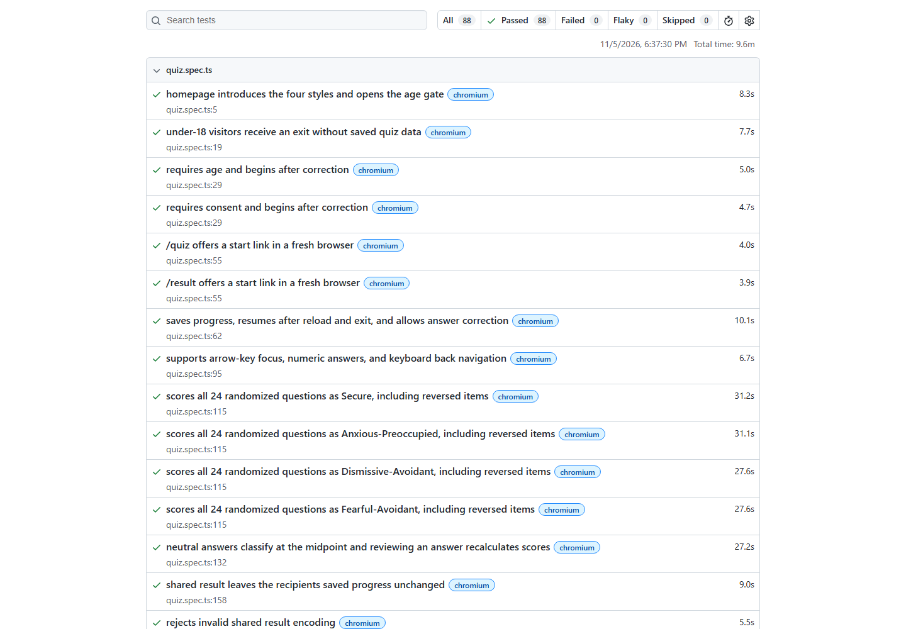

# Attachment Style Quiz — Playwright portfolio suite

Target: [Attachment Style by MTech Corp](https://quiz.mtechcorpja.com/).

This independent TypeScript suite has 22 scenarios across Chromium, Firefox,
WebKit, and Pixel 7 mobile Chromium emulation: 88 scheduled cases. It inherits
the project's two-worker limit and read-only request guard. Each test uses an
isolated browser context and synthetic answers. Service workers are blocked.
The browser requests reduced motion, which the site supports by disabling
transitions. This keeps pointer targets steady between auto-advancing questions;
the suite does not test the site's default animation behavior.

## Run and demonstrate

```sh
npm ci
npx playwright install
npm run test:quiz
npm run report:quiz
```

Use `npm run test:quiz:chromium` for a quick run, `npm run test:quiz:headed`
for a visible demonstration, or `npm run test:quiz:ui` to explore scenarios.
An equivalent staging deployment can be selected with `QUIZ_BASE_URL`.

The HTML report is in `quiz-playwright-report/`; failure screenshots, videos,
traces, and downloaded cards are in `quiz-test-results/`. Homepage and all
four pattern results have screenshot attachments. CI runs the quiz as a
separate matrix job and uploads `playwright-report-attachment-quiz`.

## Coverage

Recorded live run on November 5, 2026: **88 passed, 0 failed, 0 flaky, 0
skipped**, across all four profiles, in **9.6 minutes**. TypeScript validation
(`npx tsc --noEmit`) and `git diff --check` also passed. These results describe
this local run; GitHub Actions will generate fresh evidence after a push.



| Area | Assertions |
| --- | --- |
| Entry | HTTP response, title, four styles, age gate, under-18 exit |
| Intake | Required age and consent, correction, optional personalization |
| Question flow | 24 unique randomized questions, five answer choices, progress |
| Persistence | Reload, save and exit, resume, retained answers, answer correction |
| Navigation | Back, question grid, unavailable unanswered questions |
| Keyboard | Radio focus, Enter, numeric answers, left arrow, result tabs |
| Scoring | All four patterns, reverse scoring, exact scores, midpoint classification |
| Review | Changed answer updates scores and displays previous-score comparison |
| Sharing | Only version and scores in generated link, invalid links, recipient isolation |
| Result content | Context tabs, scenarios, partner selection, partner link validation |
| Export | Actual PNG download, signature and 1080 × 1350 dimensions |
| Preferences | Text size and contrast persist across reload |
| Clear and retake | Saved quiz keys removed; shared-result fragment cleared |
| Navigation and layout | About, privacy, corporate link, overflow across four screens |

## Scoring reference cases

The site's [About page](https://quiz.mtechcorpja.com/about) documents 12
statements per dimension. Two statements in each dimension are reverse-scored
as `6 - answer`. The adjusted responses are averaged; a mean below 3 is low,
and a mean of 3 or higher is high. Tests use fixed expected values from that
specification and do not import or execute the site's scoring implementation.

| Adjusted anxiety answers | Adjusted avoidance answers | Expected scores | Expected style |
| --- | --- | --- | --- |
| All 1 | All 1 | 1.00 / 1.00 | Secure |
| All 5 | All 1 | 5.00 / 1.00 | Anxious-Preoccupied |
| All 1 | All 5 | 1.00 / 5.00 | Dismissive-Avoidant |
| All 5 | All 5 | 5.00 / 5.00 | Fearful-Avoidant |
| All 3 | All 3 | 3.00 / 3.00 | Fearful-Avoidant, centre explanation |

Each of these five tests enters through the age gate and intake, identifies
the rendered question text, chooses the appropriate answer, and completes
all 24 questions. Reversed statements receive the opposite raw answer.
Unknown or repeated questions fail explicitly. The midpoint test changes
the final answer and checks the expected one-twelfth score movement.

Focused result UI cases open the site's documented share-link format rather
than repeating the entire quiz. Those cases verify result presentation and
interaction; the five complete journeys verify answer-to-result scoring.

## Scope and portfolio description

The network guard permits GET, HEAD, and OPTIONS and blocks other requests,
including analytics POSTs. Tests verify behavior within that guarded session;
they do not establish the site's unrestricted network privacy behavior.
The suite checks selected keyboard interactions, not full accessibility
conformance. PNG checks establish a real image download and dimensions, not
pixel-perfect visual fidelity. Mobile is emulated; WebKit is not the Safari app.
The quiz's educational content and psychological validity are outside scope.

Suggested portfolio description:

> Built a Playwright and TypeScript automation suite for a 24-question
> attachment-style quiz, covering randomized question flows, reverse-scored
> results, browser persistence, age and consent validation, score sharing,
> PNG exports, and keyboard interactions across four browser profiles.
> Added isolated HTML reports, screenshots, failure traces, and GitHub Actions.

Keep source and generated reports separate. Publish the complete HTML report
folder, including its data directory, if you want a browsable portfolio demo.
Record only results from actual completed runs; the live site can change.
